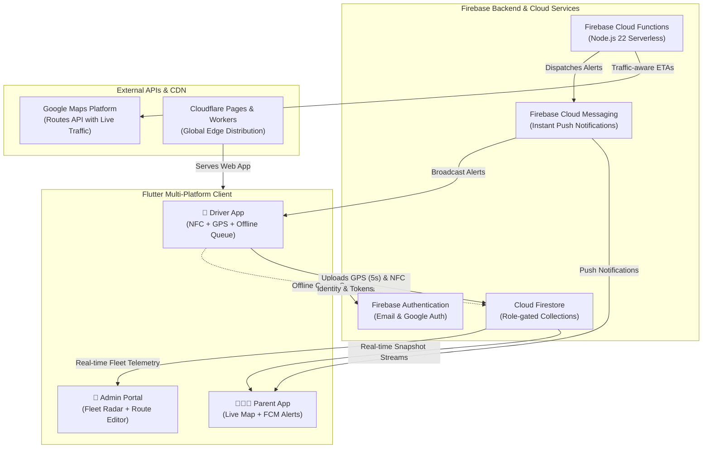

<div align="center">


# SchoolWay

### *Safer, Smarter, and Transparent School Transportation*

Live telemetry, automated NFC student attendance, and real-time traffic-aware ETAs designed for schools, drivers, and modern families.

<p align="center">
  <a href="https://flutter.dev/"></a>
  <a href="https://dart.dev/"></a>
  <a href="https://firebase.google.com/"></a>
  <a href="https://mapsplatform.google.com/"></a>
  <a href="https://pages.cloudflare.com/"></a>
</p>

[Key Features](#-key-features) • [Three Experiences](#-three-tailored-experiences) • [Architecture](#-system-architecture) • [File Categories](#-repository-anatomy--file-categories) • [Quick Start](#-quick-start) • [Configuration](#-configuration--secrets-guide) • [Testing](#-testing--quality-standards)

</div>

---

## 🌟 Why SchoolWay?

Every weekday morning, millions of parents wonder: *"Did my child make it onto the bus? Is the bus stuck in traffic? When should I head to the stop?"* Meanwhile, bus drivers juggle paper attendance sheets in morning rush hour, and school administrators manage frantic phone calls without live fleet visibility.

**SchoolWay changes the game.** Built with Flutter and serverless Cloud Architecture, SchoolWay combines real-time GPS telemetry, instant tap-and-go NFC student check-in, offline-resilient sync, and server-side Google Routes API calculations into one unified, cohesive platform.

---

## ✨ Key Features

| Capability | What It Does | Why It Matters |
| :--- | :--- | :--- |
| 🛰️ **Live Fleet Radar** | Interactive map rendering multi-bus positions, heading, and speed in real-time. | Total situational awareness for administrators and parents alike. |
| 🚦 **Traffic-Aware ETAs** | Serverless Cloud Functions calculate accurate arrival times via **Google Routes API**. | Eliminates waiting in the rain or missing the morning pickup. |
| 🪪 **NFC Tap-to-Board** | Drivers scan student cards directly from Android devices with instant sound and haptic feedback. | Replaces paper manifests with millisecond, verified boarding records. |
| 📶 **Offline-First Engine** | Built-in **Hive** local cache and retry queue that logs boarding events even when cellular signal drops. | Zero data loss in tunnels, basements, or remote rural routes. |
| 🚨 **Emergency Broadcasts** | Instant critical alerts for route disruptions, breakdowns, or delays with priority push notifications. | Keeps school staff and parents aligned during critical incidents. |
| 👥 **Multi-Profile Switcher** | Seamlessly switch between parent, driver, or admin profiles with zero-friction account management. | Perfect for parents with multiple children or staff serving dual roles. |

---

## 🎭 Three Tailored Experiences

SchoolWay uses role-based access control (RBAC) powered by Firebase Auth and custom Firestore security policies to provide three purpose-built interfaces from a single codebase:

```
┌─────────────────────────────────────────────────────────────────────────────┐
│                           SCHOOLWAY UNIFIED APP                             │
└──────────────────────────────────────┬──────────────────────────────────────┘
                                       │
         ┌─────────────────────────────┼─────────────────────────────┐
         ▼                             ▼                             ▼
  👨‍👩‍👧 PARENT APP                 🚌 DRIVER CONSOLE             🏫 ADMIN COMMAND
  ─────────────────────────     ─────────────────────────     ─────────────────
  • Live bus map tracking       • Turn-by-turn route view     • Real-time fleet radar
  • Dynamic traffic ETAs        • 1-tap NFC boarding log      • Interactive route planner
  • Child boarding history      • Offline-cached rosters      • CSV student/bus import
  • Push alert preferences      • Incident quick-reporting    • Emergency broadcasts
```

### 1. 👨‍👩‍👧 The Parent Experience
- **Live Vehicle Tracking**: Track your child's exact bus live on the map with smooth animated marker interpolation.
- **Smart Stop ETAs**: View live minutes remaining based on current traffic conditions, not static schedules.
- **Boarding Timeline**: Receive instant push notifications the moment your child boards or alights from the bus.
- **Family Hub**: Monitor all your children across different buses and grades in one clean screen.

### 2. 🚌 The Driver Console
- **Hands-Free Trip Mode**: Clean, high-contrast display designed for quick glanceability while driving.
- **NFC Student Scanning**: Fast student check-ins with clear audio-visual confirmations.
- **Offline Reliability**: Automatically saves scans to local storage when offline and syncs in the background upon reconnection.
- **Roster Overview**: Instant list of who has boarded, who is still waiting, and which stop comes next.

### 3. 🏫 The School Administrator Command Center
- **Fleet-Wide Overview**: Monitor all active routes, delays, and driver sessions simultaneously.
- **Visual Route Planner**: Create and adjust bus stops with interactive map pins and automatic polyline routing.
- **Data Provisioning Wizards**: Onboard entire schools in minutes using bulk CSV importers for students, buses, and routes.
- **Audit & Compliance**: Searchable logs for attendance corrections, route deviation reports, and driver check-in histories.

---

## 🏗️ System Architecture



---

## 📂 Repository Anatomy & File Categories

The SchoolWay codebase is organized using a clean, scalable **feature-first architecture**. Every folder and layer has a distinct responsibility:

```
schoolway/
├── android/                 # Android native runner, Gradle configs, and NFC permissions
├── assets/                  # High-resolution icons, brand assets, and map markers
├── functions/               # Serverless Node.js backend (Routes API & notification engine)
├── ios/                     # iOS native runner, Xcode workspace, and entitlements
├── lib/                     # Main Flutter / Dart application source code
│   ├── app.dart             # Root application widget, theme provider, and route gates
│   ├── core/                # Shared foundational infrastructure & design system
│   ├── features/            # Feature modules divided by user role
│   ├── models/              # Immutable domain entities & serialization
│   ├── services/            # Hardware integrations & cloud service clients
│   └── l10n/                # Internationalization strings (ARB catalogs)
├── seed/                    # Ready-to-import demo CSV datasets for quick evaluation
├── test/                    # Unit, widget, and integration test suites
├── tool/                    # Standards verification, latency benchmarks, and CLI tools
├── web/                     # Web platform runner, service workers, and PWA manifest
└── windows/                 # Windows desktop native host configuration
```

### 📑 Detailed File Categories Breakdown

| Category | Primary Directory | Description & Key Files |
| :--- | :--- | :--- |
| **🎨 UI Design System & Core** | [`lib/core/`](file:///d:/UTAR/schoolway/lib/core/) | Core design tokens, `SchoolWayTheme`, custom accessible widgets (`SlideToConfirm`, `ShimmerLoading`, `TrafficEtaChip`), AppLogger diagnostics, and `SchoolWayMap` controller. |
| **👨‍👩‍👧 Parent Experience** | [`lib/features/parent/`](file:///d:/UTAR/schoolway/lib/features/parent/) | Live vehicle tracking map (`LiveMapTab`), child roster (`ChildrenTab`), trip history viewer, and notification preferences. |
| **🚌 Driver Experience** | [`lib/features/driver/`](file:///d:/UTAR/schoolway/lib/features/driver/) | Active trip console (`DriverTripTab`), NFC boarding scanner (`DriverNfcTab`), driver navigation map, and student checklist. |
| **🏫 Admin Command Center** | [`lib/features/admin/`](file:///d:/UTAR/schoolway/lib/features/admin/) | Multi-bus fleet radar (`LiveFleetTab`), visual route builder (`RoutePlannerScreen`), geofence editor, and CSV onboarding wizard. |
| **🔐 Authentication & Shell** | [`lib/features/auth/`](file:///d:/UTAR/schoolway/lib/features/auth/) & [`lib/features/profile/`](file:///d:/UTAR/schoolway/lib/features/profile/) | Role-gated sign-in (`SignInScreen`), Google profile completion, startup recovery, and multi-profile switcher. |
| **📦 Domain Entities** | [`lib/models/`](file:///d:/UTAR/schoolway/lib/models/) | Strongly typed, immutable data models (`Bus`, `Student`, `PlannedRoute`, `RouteSession`, `BoardingEvent`, `EmergencyAlert`). |
| **⚡ Application Services** | [`lib/services/`](file:///d:/UTAR/schoolway/lib/services/) | `FirebaseService`, `LocationService`, `OfflineQueueService` (Hive-backed queue), `EtaGeofenceService`, and `NfcTagReader`. |
| **🌐 Localization** | [`lib/l10n/`](file:///d:/UTAR/schoolway/lib/l10n/) | Localized string catalog supporting multi-language environments (`app_en.arb`, generated localization classes). |
| **☁️ Cloud Functions** | [`functions/`](file:///d:/UTAR/schoolway/functions/) | Secure serverless backend (`index.js`), Google Routes API proxy (`routes_client.js`), and push notification policy engine (`notification_policy.js`). |
| **🧪 Quality & Testing** | [`test/`](file:///d:/UTAR/schoolway/test/) | 170+ unit and widget tests validating state changes, map marker bounds, offline queuing, and accessibility contrast. |
| **🌱 Onboarding Seeds** | [`seed/`](file:///d:/UTAR/schoolway/seed/) | Pre-configured template CSV files (`buses.csv`, `students.csv`, `users.csv`, `planned_routes.csv`) for instant import. |

---

## 🚀 Quick Start

Get SchoolWay running locally in under 3 minutes:

### Prerequisites
- [Flutter SDK](https://docs.flutter.dev/get-started/install) (`>= 3.47.1`)
- [Dart SDK](https://dart.dev/get-dart) (`>= 3.10.0`)
- Android Studio / Xcode / Chrome for target emulation

### 1. Clone & Enter Repository
```bash
git clone https://github.com/ChaiBoonHong/schoolway-0428.git
cd schoolway-0428
```

### 2. Fetch Dependencies
```bash
flutter pub get
```

### 3. Launch on Your Target Device
```bash
# Run on Chrome / Web (Instant Dev Preview)
flutter run -d chrome

# Run on connected Android phone or emulator
flutter run -d android

# Run on Windows Desktop
flutter run -d windows
```

> [!NOTE]
> Pre-configured development credentials are included for immediate UI exploration. Connect your own Firebase project and Google Maps API keys below for production deployment.

---

## 🔐 Configuration & Secrets Guide

SchoolWay keeps client configurations safe and separates credentials cleanly:

```
┌────────────────────────────────────────────────────────────────────────┐
│                            SECRET INVENTORY                            │
├────────────────────────┬─────────────────────────────┬─────────────────┤
│ Credential             │ Location                    │ Purpose         │
├────────────────────────┼─────────────────────────────┼─────────────────┤
│ Firebase Client Config │ lib/firebase_options.dart   │ Client Auth/DB  │
│ Google Services JSON   │ android/app/google-services │ Android Native  │
│ Google Maps Android    │ android/local.properties    │ Android Maps    │
│ Google Routes API Key  │ Cloud Functions Secrets     │ Traffic ETAs    │
│ Google Maps Web Key    │ GitHub Secrets / web index  │ Web Map / CI    │
│ Cloudflare Token & ID  │ GitHub Actions Secrets      │ Global Edge CI  │
└────────────────────────┴─────────────────────────────┴─────────────────┘
```

### 1. Connecting Your Firebase Project
1. Install [FlutterFire CLI](https://firebase.flutter.dev/docs/cli/):
   ```bash
   dart pub global activate flutterfire_cli
   flutterfire configure
   ```
2. Deploy Firestore security rules and database indexes:
   ```bash
   firebase deploy --only firestore:rules,firestore:indexes
   ```

### 2. Google Maps Platform Keys
- **Android Maps**: Add your restricted API key to `android/local.properties` (ignored by Git):
  ```properties
  MAPS_API_KEY=AIzaSyYourAndroidMapsApiKeyHere
  ```
- **Server-Side Routes API**: Save your Routes API key in Firebase Secret Manager so keys are never exposed on clients:
  ```bash
  cd functions
  firebase functions:secrets:set GOOGLE_ROUTES_API_KEY
  ```

---

## 🧪 Testing & Quality Standards

SchoolWay adheres to rigorous software engineering, security, and accessibility standards:

```bash
# 1. Run full Flutter unit and widget test suite (170+ tests)
flutter test

# 2. Run Cloud Functions serverless backend tests (68 tests)
cd functions && npm test && cd ..

# 3. Verify static analysis and zero lints
flutter analyze

# 4. Verify code formatting
dart format --output=none --set-exit-if-changed lib test tool

# 5. Verify repository standards
dart run tool/verify_project_standards.dart
```

---

## 🚢 CI/CD & Deployment

Automated multi-stage continuous delivery via [`.github/workflows/deploy-web.yml`](file:///d:/UTAR/schoolway/.github/workflows/deploy-web.yml):
1. **Standards Gate**: Executes Gitleaks secret detection, code formatting, and architecture verification.
2. **Quality Gates**: Runs concurrent Flutter test suites and Node.js Functions security audits (`npm audit`).
3. **Automated Production Build**: Compiles web bundles and deploys to **Cloudflare Pages & Workers** with global CDN caching.

---

<div align="center">

### Built with care for safe journeys home.

**SchoolWay** · Every child accounted for, every journey visible.

</div>
